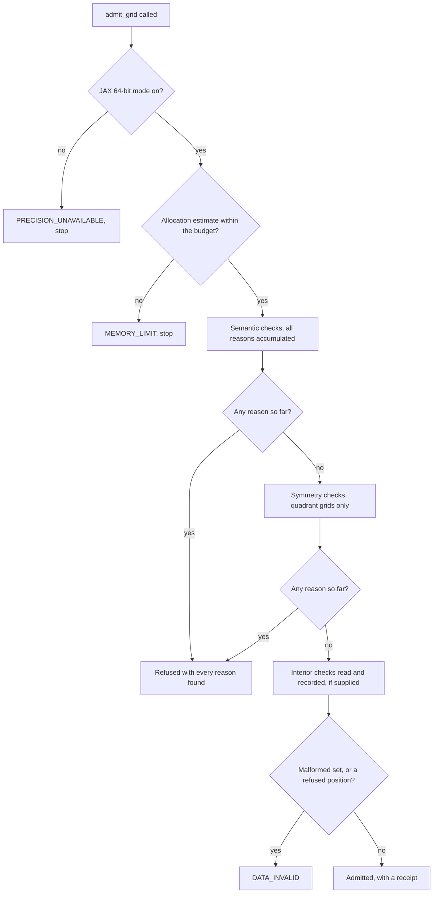

# What does a refusal protect you from?

A grid that is too coarse does not fail loudly. Its reads still return
images, and each one is wrong by an amount nobody checks. Admission exists to
catch that before the first read, and every read checks its own position
too. Both report what went wrong as named reason bits. This page asks how
the library decides from the spacing alone that a delivery is unusable, what
it says when it refuses, and why version 0.1 reports every error bound as
unknown.

:::{admonition} The question of this page
:class: important

How does admission turn a spacing into a refusal, which reasons can it
give and in what order does it look, and what does it leave unsaid? The
sections answer these in turn, and the close fills in the answers.
:::

```{code-cell} python
:tags: [remove-cell]
import math
import tempfile
from pathlib import Path

import hwostyle
import jax
import jax.numpy as jnp
import matplotlib.pyplot as plt
import numpy as np
from IPython.display import Markdown, Video
from myst_nb import glue

import eyepiece as ep

jax.config.update("jax_enable_x64", True)
hwostyle.use("dark")
pal = hwostyle.palette

import sinchole as sc
import toy_coronagraph as tc

_clips = iter(range(100))


def clip(anim):
    """Embed an animation as an mp4 with the browser's own player controls."""
    path = Path(tempfile.gettempdir()) / f"sinchole-docs-admission-{next(_clips)}.mp4"
    anim.video(path, dpi=200)
    return Video(str(path), embed=True, html_attributes="controls loop muted playsinline")


def tex_str(value):
    """Format a number as a LaTeX power of ten."""
    mantissa, exponent = f"{value:.1e}".split("e")
    return rf"${mantissa}\times10^{{{int(exponent)}}}$"


def tex(value):
    """Return the power of ten as a Markdown display object."""
    return Markdown(tex_str(value))


def put(name, text):
    """Glue a Markdown string under a name the prose can cite."""
    glue(name, Markdown(text), display=False)
```

## Does a slightly coarser grid cost a slightly larger error?

The toy grid of {doc}`first-read` ({ref}`the toy in numbers <toy-in-numbers>`)
has spacing $h=0.38$ $\lambda_0/D$. Its oversampling factor is
$\rho=2Bh=0.76$, where $B=1$ is the bandwidth of the toy's one-diameter pupil
({doc}`../theory/band-limits`), and that sits exactly at the kernel margin of
the {doc}`kernel page <../theory/kernel>`. Suppose a designer saves
propagations by coarsening the spacing to $h=0.45$, which is $\rho=0.90$.

The curve below is the central object of this page. It is the kernel's
**worst-tone error**: the largest error the 32-tap kernel makes when it
rebuilds a unit-amplitude single cosine, over every frequency the grid
claims to hold, so it is an error divided by the signal's amplitude. The
horizontal axis is $\rho$, which grows with the spacing, and the vertical
lines mark the margin and the Nyquist limit.

```{code-cell} python
:tags: [hide-input]
rho_frames = np.unique(np.concatenate([np.arange(0.5, 1.0001, 0.0125), [0.76]]).round(4))
spacings = rho_frames / 2
errors = np.array([tc.kernel_error_worst(r) for r in rho_frames])
rho_toy, rho_coarse = 0.76, 0.90

fig, ax = plt.subplots(figsize=(7.5, 3.9), constrained_layout=True)
ax.semilogy(rho_frames, errors, color=pal.cyan, lw=2)
ax.set_xlim(0.5, 1.03)
ax.set_ylim(1e-8, 3)
ax.set_xlabel(r"oversampling factor $\rho = 2Bh$ (spacing $h = \rho / 2$)")
ax.set_ylabel("kernel worst-tone error / amplitude")
ep.plot.ref_line(ax, 0.76, "margin 0.76", orient="v", where="end")
ep.plot.ref_line(ax, 1.0, "Nyquist 1", orient="v", where="end")
for rho_mark, color in ((rho_toy, pal.yellow), (rho_coarse, pal.pink)):
    ax.plot([rho_mark], [errors[rho_frames == rho_mark][0]], "o", color=color, ms=7)
    ax.text(rho_mark - 0.012, 2e-8, rf"$h$ = {rho_mark / 2:.2f}", color=color,
            ha="right", fontsize=10)
plt.show()
```

Look at the flat stretch at the left and the steep rise right after the
margin. The yellow point is the toy grid and the pink point is the coarsened
grid.

```{admonition} Predict before reading on
:class: tip
Reading the curve, by what factor does the worst-tone error grow from the
yellow point to the pink point: about 2, about 100 or about 60,000?
```

```{code-cell} python
:tags: [remove-cell]
before = errors[rho_frames == rho_toy][0]
after = errors[rho_frames == rho_coarse][0]
growth = after / before
glue("a_before", tex(before), display=False)
glue("a_after", tex(after), display=False)
glue("a_growth", tex(growth), display=False)
put("a_growth_n", f"{growth:,.0f}")
```

```{dropdown} Answer
About {glue}`a_growth_n`. At $h=0.38$ the worst-tone error is {glue}`a_before` of
the amplitude, and at $h=0.45$ it is {glue}`a_after`, a factor near
{glue}`a_growth`. The curve is a cliff and not a slope, so there is no
gentle middle in which a slightly coarse grid is slightly wrong. The error stays near its floor up to the
margin, and past it rises through several decades before the Nyquist limit.
```

The clip below adds the verdict of `admit_grid`, run on a real toy delivery
at each spacing. The head moves along the same curve, and the verdict text
changes where admission changes its answer. Each delivery in the sweep has
17 nodes per axis, the smallest quadrant grid admission accepts (a stencil
needs 16 nodes and one more), so the sweep builds the cheapest delivery at
each spacing, and a box of half-width 1 is enough to overlap the served
region.

```{code-cell} python
:tags: [hide-input]
verdicts = []
for h in spacings:
    delivery_h = tc.quadrant_delivery(spacing=float(h), nodes=17, domain_half=1.0)
    outcome = sc.admit_grid(**delivery_h)
    verdicts.append(sc.reason_names(outcome.reason_bits) if not outcome.admitted else ())
hold = lambda a, n: np.concatenate([np.full(n, a[0]), a, np.full(n + 3, a[-1])])
order = hold(np.arange(len(rho_frames)), 3)

fig, ax = plt.subplots(figsize=(7.5, 3.9), constrained_layout=True)
ax.set_yscale("log")
ax.set_xlim(0.5, 1.03)
ax.set_ylim(1e-8, 3)
ax.set_xlabel(r"oversampling factor $\rho = 2Bh$ (spacing $h = \rho / 2$)")
ax.set_ylabel("kernel worst-tone error / amplitude")
ep.plot.ref_line(ax, 0.76, "margin 0.76", orient="v", where="end")
ep.plot.ref_line(ax, 1.0, "Nyquist 1", orient="v", where="end")
ep.motion.carried_tag(ax, r"kernel error against $\rho$", corner="upper left")
(curve,) = ax.plot([], [], color=pal.cyan, lw=2)
(head,) = ax.plot([], [], "o", color=pal.cyan, ms=7)
verdict = ax.text(0.03, 0.84, "", transform=ax.transAxes, va="top", fontsize=13)
spacing_text = ax.text(0.03, 0.73, "", transform=ax.transAxes, va="top", fontsize=10,
                       color=ep.style.neutral(0.7))


def draw(fig, k):
    k = int(k)
    curve.set_data(rho_frames[: k + 1], errors[: k + 1])
    head.set_data([rho_frames[k]], [errors[k]])
    names = verdicts[k]
    verdict.set_text("admitted" if not names else " + ".join(names))
    verdict.set_color(ep.style.role("text") if not names else ep.style.role("alert"))
    spacing_text.set_text(rf"spacing $h$ = {spacings[k]:.4f} $\lambda_0/D$, error " + tex_str(errors[k]))


anim = ep.render.animate(fig, draw, order, fps=10)
clip(anim)
```

The still below shows three frames of the clip, at $\rho$ below the margin,
between the margin and the Nyquist limit, and at the limit.

```{code-cell} python
:tags: [hide-input]
fig, axes = plt.subplots(1, 3, figsize=(9, 3.2), sharey=True, constrained_layout=True)
for ax, rho_pick in zip(axes, (0.7, 0.9, 1.0)):
    k = int(np.argmin(np.abs(rho_frames - rho_pick)))
    ax.semilogy(rho_frames, errors, color=ep.style.neutral(0.35), lw=1.5)
    ax.semilogy(rho_frames[: k + 1], errors[: k + 1], color=pal.cyan, lw=2)
    ax.plot([rho_frames[k]], [errors[k]], "o", color=pal.cyan, ms=6)
    ax.axvline(0.76, color=ep.style.neutral(0.4), lw=1, ls="--")
    names = verdicts[k]
    ax.set_title("admitted" if not names else "\n".join(names), fontsize=9,
                 color=ep.style.role("text") if not names else ep.style.role("alert"))
    ax.set_xlabel(rf"$\rho$ = {rho_frames[k]:.2f}")
    ax.set_xlim(0.5, 1.03)
    ax.set_ylim(1e-8, 3)
axes[0].set_ylabel("worst-tone error / amplitude")
plt.show()
```

Look at the titles: admission flips from admitted to `KERNEL_MARGIN_FAIL` just
past $\rho=0.76$, where the error leaves its floor, and adds `NYQUIST_FAIL`
at $\rho=1$. This is why admission compares the spacing with the margin
before any read, using the declared support width, and refuses with a reason
that names the fix.

## Which refusals can a delivery expect, and what fixes each?

Every reason bit sinchole defines is listed below, generated from the
`sc.Reason` enumeration so that no bit can be missing. The **When** column
says where the bit can appear: at admission, at read time, at both, or
reserved (defined, but never set by sinchole itself). A refusal can carry
several reasons at once, and `sc.reason_names(bits)` lists them.

```{code-cell} python
:tags: [remove-input]
R = {
    "LAYOUT_UNSUPPORTED": ("admission", "Lattice spacing or origin outside 1e-6 to 1e6, or a reflection kind that version 0.1 does not know", "Use a supported layout and values in range"),
    "GRID_INCOMPLETE": ("admission", "Node indices are missing from the declared rectangle", "Deliver the complete rectangle"),
    "GRID_DUPLICATE": ("admission", "A node index appears twice", "Deliver each node once"),
    "GRID_NONUNIFORM": ("admission", "Offsets disagree with the declared lattice beyond four ULPs, the origin or spacing is not finite and positive, or a quadrant grid does not start at zero", "Check the coordinate conversion, or pass `offset_original_dtype`"),
    "DATA_INVALID": ("admission", "A node holds a non-finite or negative value, or the interior check set is malformed (empty, non-finite or negative images, missing identifiers) or has a position the reader refuses", "Repair the data or the check set"),
    "METADATA_MISSING": ("admission", "A premise, identity, provenance or shortest sampling wavelength is unknown or empty", "Supply the declaration, since sinchole never assumes a premise"),
    "METADATA_CONFLICT": ("admission", "Wavelengths, limits, the campaign minimum, the product kind or the domain contradict each other, or premise 6 is declared false", "Make the declarations agree"),
    "NORMALIZATION_UNSUPPORTED": ("admission", "The normalization reference, photon conversion or provenance is unsupported or missing, or premise 5 is declared false", "Declare a supported normalization"),
    "FRAME_UNSUPPORTED": ("admission", "Premises 1 to 4 are declared false, or the pupil frame or pixel basis is unsupported", "Correct the declaration, or deliver a model for which the premise holds"),
    "UNKNOWN_BANDWIDTH": ("admission", "The support widths are not positive, their evidence is not a declared source, or a source identifier is empty", "Declare the full illuminated entrance widths with a source"),
    "NYQUIST_FAIL": ("admission", "$\\rho\\ge1$ on some axis: the grid cannot determine the image between nodes", "Propagate a finer grid; this always comes with `KERNEL_MARGIN_FAIL`"),
    "KERNEL_MARGIN_FAIL": ("admission", "$\\rho>0.76$ on some axis: too coarse for the kernel's accuracy", "Propagate a finer grid, or check the declared support width and shortest wavelength"),
    "INCOMPLETE_STENCIL": ("both", "At a read, the query's 32 by 32 stencil runs off the stored nodes. At admission, the grid has fewer than 17 nodes per quadrant axis (32 per full-grid axis), or no served position has a complete stencil", "Read inside the served region, or deliver a larger rectangle"),
    "OUTSIDE_DOMAIN": ("read", "The query is outside the permission region", "Read inside the region"),
    "SYMMETRY_UNSUPPORTED": ("admission", "The symmetry declaration is incomplete or malformed (both axes, evidence, identifiers, tolerance no looser than 1e-6), or conflicts with the grid", "Complete the declaration"),
    "PRECISION_UNAVAILABLE": ("admission", "JAX 64-bit mode is off", "`jax.config.update(\"jax_enable_x64\", True)` before building arrays"),
    "MEMORY_LIMIT": ("admission", "An allocation estimate exceeds the `MemoryBudget`", "Raise the ceilings or tile reads more finely"),
    "NONFINITE_QUERY": ("read", "The query position is NaN or infinite", "Pass a finite position"),
    "PRODUCT_UNAVAILABLE": ("read", "The product index is not in the delivery", "Use an index the delivery has"),
    "BOUND_UNKNOWN": ("read", "No error bound exists. Version 0.1 sets it on every read, accepted or not, and a bounded policy refuses because of it", "Nothing to fix in a sampling read; bounded reads need a future error model"),
    "TOLERANCE_EXCEEDED": ("reserved", "Defined, and set by neither sinchole nor yippy in version 0.1", "None"),
    "EXTRA_MISSING": ("reserved", "Set by yippy when the sinchole extra is not installed, never by sinchole", "Install `yippy[sinc]`"),
    "FALLBACK_USED": ("reserved", "Set by yippy when a read fell back to blend, never by sinchole", "Informational"),
    "EMPIRICAL_ONLY": ("read", "The only accuracy evidence is the finite set of empirical checks. Set whenever checks exist", "Informational"),
    "SYMMETRY_CHECK_FAILED": ("admission", "A mirror or axis residual exceeds its tolerance (at most $10^{-6}$) of the local peak", "The optics are not mirror symmetric at that level, so deliver a full signed grid"),
    "SYMMETRY_CHECK_MISSING": ("admission", "A quadrant grid lacks mirror checks, or one of the three negative counterparts", "Propagate the missing mirror checks"),
    "SYMMETRY_REFERENCE_INVALID": ("admission", "A mirror check image is unusable: non-finite or negative values, offsets off the lattice, a missing identifier, or no positive local peak", "Repair the mirror check set"),
}
assert {r.name for r in sc.Reason} == set(R), "the table and sc.Reason disagree"
rows = ["| Bit | Reason | When | What it means | What to do |", "|---|---|---|---|---|"]
for reason in sc.Reason:
    when, meaning, fix = R[reason.name]
    rows.append(f"| {reason.value.bit_length() - 1} | `{reason.name}` | {when} | {meaning} | {fix} |")
Markdown("\n".join(rows))
```

## A refusal, end to end

The toy grid at $h=0.38$ is exactly at the margin. Coarsening it to
$h=0.45$ gives $\rho=0.9$, which the clip shows is past the cliff, and
admission should refuse before any read. The delivery keeps the permission
box of half-width $R=5$ $\lambda_0/D$. A quadrant grid that serves positions
up to $R$ needs $\lceil R/h\rceil+16$ nodes per axis ({doc}`designers`), which
is 28 at this spacing, so the only thing wrong with the grid is the spacing.

```{code-cell} python
nodes_needed = math.ceil(5.0 / 0.45) + 16
coarse = tc.quadrant_delivery(spacing=0.45, nodes=nodes_needed)
refused = sc.admit_grid(**coarse)
print("nodes per axis:", nodes_needed)
print("admitted:", refused.admitted)
print("reasons:", sc.reason_names(refused.reason_bits))
try:
    refused.require()
except sc.AdmissionRefused as err:
    print("AdmissionRefused:", err, "| receipt attached:", err.receipt is not None)
```

The only reason is `KERNEL_MARGIN_FAIL`: $\rho=0.9$ is below the Nyquist limit
but above the margin. The exception carries the reasons in its message and
the receipt of what was checked.

## What does admission check, and in what order?

Admission checks in a fixed order. Two failures end the run at once, and the
rest are accumulated into one report or skipped once an earlier group has
failed, as the flowchart shows.



1. **Precision.** If JAX 64-bit mode is off, `PRECISION_UNAVAILABLE` is
   returned alone.
2. **Memory.** An allocation estimate from the declared array sizes is compared
   with the `MemoryBudget`. A breach returns `MEMORY_LIMIT` alone, before any
   other check and before anything large is allocated.
3. **Semantic checks, accumulated together.** Structure (array shapes and
   dtypes), metadata and the six premises with their evidence, geometry (a
   supported layout, a complete rectangle without duplicates, offsets within
   four ULPs of the declared lattice, values in the supported numeric range
   with `LAYOUT_UNSUPPORTED` and `GRID_NONUNIFORM` for violations), node
   data (finite and non-negative, else `DATA_INVALID`), bandwidth
   ($\rho=2(\lambda_0/\lambda_{\min})Lh$ for support width $L$; `NYQUIST_FAIL` when $\rho$ is
   not below 1 and `KERNEL_MARGIN_FAIL` when $\rho$ is above 0.76, using the
   shortest contributing wavelength and, if given, the campaign minimum), the
   stencil minimum (`INCOMPLETE_STENCIL`) and the memory estimate again with
   the full set of arrays. All reasons found here are reported together.
4. **Symmetry.** For quadrant grids, the declared reflection, a tolerance no
   looser than $10^{-6}$, every mirror residual and every axis-invariance
   check, computed from the images. These run only if no earlier reason was
   found.
5. **Empirical interior checks.** If a `CheckSet` is supplied, each check is
   read and its residual is recorded in the receipt. The residual never gates
   admission: a large one is evidence, not a refusal. Only a malformed
   check set (non-finite values, missing identifiers) or a check position the
   reader refuses returns `DATA_INVALID`.

Because the symmetry checks wait for everything earlier, a delivery with a
semantic problem never learns whether it would also have failed a mirror
check. The residual denominator also differs by check type. The mirror and
axis checks recompute their local peak from the delivered images, but the
interior check divides by the `core_peak` the delivery supplied, which the
library does not recompute.

## What does the receipt record about a decision?

The `Receipt` is a small, immutable host-side record of the admission. Its
`identity` hashes the data, the declarations and the provenance text, so it
changes whenever any of them does. The cell prints the main fields of the
receipt of the toy grid of {doc}`first-read`, which was admitted.

```{code-cell} python
receipt = sc.admit_grid(**tc.quadrant_delivery(tc.ToyCoronagraph())).receipt
print("identity:", receipt.identity[:16], "...")
print("stored bounds (lod):", receipt.stored_bounds_xy)
print("served geometry:", receipt.served_geometry[:3])
print("offset residual, x and y:", receipt.canonicalization_residual_xy)
print("premises (value, evidence, source):", receipt.premise_evidence[0])
print("mirror residuals:", len(receipt.mirror_local_peak), "values, worst",
      f"{max(receipt.mirror_local_peak):.1e}")
print("axis checks:", len(receipt.axis_exact), "images,", sum(receipt.axis_exact),
      "exactly flip-symmetric, worst relative residual",
      f"{np.nanmax(receipt.axis_relative):.1e}")
print("allocation estimate (bytes):", dict(receipt.allocation_estimate))
print("interior check residuals:", receipt.empirical_local_peak)
```

The stored bounds and served geometry say where nodes exist and where reads
are allowed. The offset residual is how far the delivered positions were
from the declared lattice. The mirror and axis entries are the symmetry
evidence (an axis check passes either by exact identity or by a relative residual within the tolerance), and the empty interior-check entry is because this delivery
supplied no `CheckSet`. The other recorded evidence is the interior
residuals (`empirical_local_peak`, `empirical_absolute`) when checks exist.
The function `sinchole.viz.plot_check_residuals` draws the evidence fields.

## Why does version 0.1 report every error bound as unknown?

A read under the default `ReadPolicy` is a sampling read: it returns the
image whenever the grid was admitted and the query is served, and reports
`abs_error_bound = inf` and `bound_available = False`. That is not a claim
that the error is large. It is a refusal to claim anything the library
cannot support.

The interior and mirror checks in the receipt are evidence
about the delivered model at specific positions, and the comparisons on
{doc}`first-read` and {doc}`../validation` show what that evidence looks
like, but neither is a bound at other positions. A bounded `ReadPolicy`
requires an error model that can certify every term of the error budget,
which version 0.1 does not have, so every bounded request refuses with
`BOUND_UNKNOWN`. The {doc}`../roadmap` describes the certificates that will
change this.

## What did this page establish?

The question was how a spacing becomes a refusal, which reasons admission can
give and in what order, and what it leaves unsaid. The answers, filled in:

- **From spacing to refusal:** admission computes $\rho=2Bh$ from the declared
  support width and refuses above 0.76, because the kernel's worst-tone error
  rises by a factor near {glue}`a_growth_n` between $h=0.38$ and $h=0.45$.
- **Reasons:** every bit of `sc.Reason` is in the table, and a refusal lists all
  that apply.
- **Order:** precision and memory end the run alone, then semantic checks,
  then symmetry, then interior checks, as in the flowchart.
- **Unsaid:** version 0.1 reads without a certified bound, so the receipt's
  checks are evidence and never a bound.

A delivery that passes is the designer's job to build, which the next page
walks through.

Next: {doc}`designers`.
