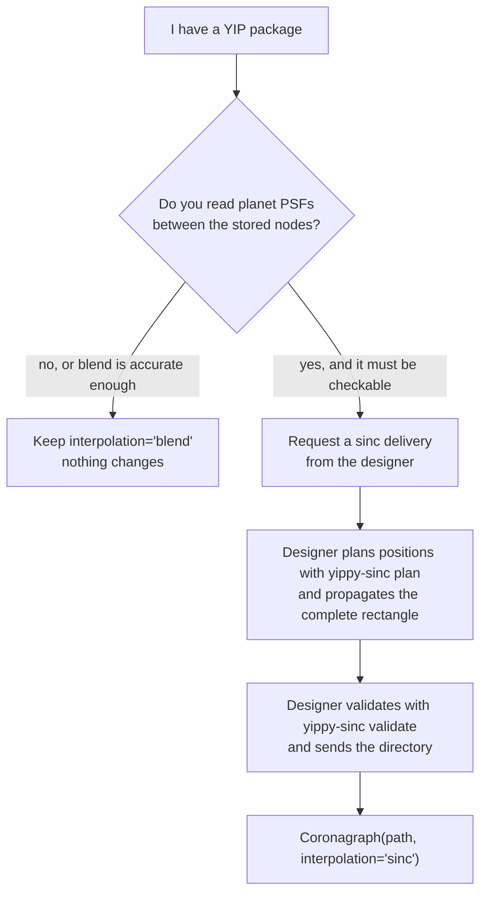

# Reading deliveries through yippy

Most users never call sinchole directly. A coronagraph designer delivers a
directory of FITS files with a JSON manifest, and
[yippy](https://yippy.readthedocs.io) opens it as a `Coronagraph` whose
off-axis PSFs come from sinchole. The yippy package owns everything about files (parsing,
units, hashes, caches and the choice of backend), and sinchole owns the
grid validation, the reads and their refusals. This page shows the yippy side
of that division.

:::{note}
The sinchole backend for yippy is optional and lives behind yippy's `sinc`
extra (`pip install "yippy[sinc]"`). Enable JAX 64-bit mode before
constructing a `Coronagraph` with sinc reads.
:::

## Choosing the interpolation backend

`Coronagraph` takes an `interpolation` argument with three values.

`"blend"` (the default)
: The existing yippy interpolation of tabulated PSFs. Legacy YIP packages,
  their caches and their results are unchanged bit for bit.

`"sinc"`
: Strict sinchole reads. The constructor raises if the delivery is not a
  versioned sinc delivery, if the sinchole extra is missing, if JAX 64-bit
  mode is off, or if admission refuses the grid.

`"auto"`
: The sinchole reader serves reads when the delivery is a versioned sinc delivery and admission
  succeeds, otherwise the blend backend with the reason recorded in
  `coro.interpolation_info`. Data errors (a corrupted hash, a header that
  disagrees with the manifest, an unknown unit) always raise, even in auto
  mode, because they mean the files are wrong rather than that sinc is
  unavailable.

```python
import jax

jax.config.update("jax_enable_x64", True)

from yippy import Coronagraph

coro = Coronagraph("path/to/delivery", interpolation="sinc")
image = coro.create_psf(4.0, 5.5)            # planet at (4.0, 5.5) lambda0/D
image, info = coro.create_psf_with_info(4.0, 5.5)
print(coro.interpolation_info.effective)     # "sinc"
print(coro.interpolation_info.receipt_id)    # the admission receipt identity
```

A quadrant delivery has no blend representation, so `"auto"` on a quadrant
delivery either reads with sinchole or raises, and it never falls back.

## I already have a YIP: keep blend or request a sinc delivery?

```{code-cell} python
:tags: [remove-cell]
import sys

sys.path.insert(0, "../scripts")
from IPython.display import Markdown
from myst_nb import glue
from validation_tables import load, sci

v = load("validation.json")
glue("y_sinc", Markdown(sci(v["worst_check_error_local_peak"])), display=False)
glue("y_blend", f"{100 * v['blend_worst_error_local_peak']:.0f}", display=False)
glue("y_n", str(v["independent_checks"]), display=False)
```

An existing YIP package keeps working through `"blend"` with no change, so
the question is whether the science needs reads between nodes at a level that
blend cannot give. On the {glue:text}`y_n` interior checks of the public starter, the sinchole
reads sit at {glue}`y_sinc` of the local peak at worst and the blend
reader on the same checks is off by {glue:text}`y_blend` percent by the same
measure, so the choice matters only for work that reads a planet at positions
nobody propagated.



A YIP cannot be promoted by editing its files. A sinc delivery needs a
complete lattice at the planned spacing, pixel-integral images in a fixed
frame, and mirror and interior checks that were propagated directly, and a
YIP carries none of the three. What changes for the designer is the position
list and the checks. What does not change is the stellar and sky products:
they stay in their legacy YIP layout, unchanged, in the directory named by
the manifest key `legacy_package_path`.

## Why does `Coronagraph` need the stellar products?

`Coronagraph(path, interpolation="sinc")` builds the whole coronagraph
object, and the object also serves the stellar intensity and the sky
transmission, which sinchole does not read. They come from the legacy
products (`stellar_intens.fits` and the others of a YIP package) in
`legacy_package_path`. A delivery meant for direct `Coronagraph` use must
therefore include them. The public starter holds none, so it is read through
yippy's router (`route_interpolation`), which returns the sinc backend
without them, and `yippy-sinc validate` checks its files either way. The
example below is not executed on this page, because the starter's release
asset is not published yet, and it follows the quickstart on yippy's schema
page.

```python
import jax

from yippy.datasets import fetch_sinc_starter
from yippy.sinc_routing import route_interpolation

jax.config.update("jax_enable_x64", True)

path = fetch_sinc_starter()
_, backend, info = route_interpolation(path, "sinc", None, None)
psf = backend.create_psf(3.9425, 5.415)      # inside the declared corner cell
print(info.effective)                          # "sinc"
```

The position lies in the corner cell that the starter declares as served. A
position outside that cell is refused for this delivery, although the stored
nodes could support it ({doc}`../validation`).

## Options

`SincOptions` selects a product and passes construction controls through to
sinchole.

```python
from yippy.interpolation import SincOptions
import sinchole as sc
import jax.numpy as jnp

options = SincOptions(
    product_id="mono-000",                     # required for multi-plane deliveries
    domain=sc.Domain(                          # optional narrower permission region
        "box", "closed", jnp.array([[-4.0, -4.0], [4.0, 4.0]]), jnp.zeros(2)
    ),
)
coro = Coronagraph("path/to/delivery", interpolation="sinc", sinc_options=options)
```

A caller domain narrower than the delivery's served region excludes the
delivered independent checks that fall outside it, and the receipt lists them
as excluded. Checks outside the delivery's own served region are a data error.
A bounded `ReadPolicy` never falls back to blend: version 0.1 cannot issue
bounds, so a bounded request refuses.

## What yippy checks before routing

Every declaration and integrity check runs before yippy decides between sinc
and blend, so a damaged delivery cannot slip through a fallback.

The checks
cover the SHA-256 hash of every referenced file (images, offsets, coordinate
lists, independent checks, mirror checks and reports), agreement between FITS
headers and the manifest, the order of domain bounds, consistency of layout
and reflection, a complete rectangle and authoritative integer indices.
Missing physical metadata, such as the coordinate model or a premise, is
classified as missing (auto falls back with that reason, strict sinc raises),
while metadata that defines units or geometry (detector shape, center and
pitch, sample kind, normalization and photon conversion) is always a data
error.

## Units and frames

Off-axis images keep the delivered units, photon fraction per pixel for a
pixel-integral delivery, and sinchole applies no normalization of its own.
Stellar and sky products keep their own frame and pixel scale, which may
differ from the off-axis frame. The `PIXSCALE` header is in reference
lambda/D per pixel. An empty header comment means that schema unit, a named
angular unit (arcsec, mas, deg, rad) is converted, and an unknown unit raises.

## The delivery manifest at a glance

A sinc delivery is a directory whose `sinc-delivery.json` manifest (schema
`sinc-delivery-0.1`) names every file and its hash. Every manifest key, CSV
column, FITS HDU and header keyword is defined on yippy's
[schema page][schema], and this page does not repeat them. The
designer-facing checklist is on {doc}`designers`, the step-by-step recipe is
on {doc}`delivery-recipe`, and the `yippy-sinc` command line has two
commands that a designer needs.

`yippy-sinc plan`
: Writes the training, check and mirror-check lists from the wavelengths,
  support and served limit.

`yippy-sinc validate <dir>`
: Runs the yippy integrity checks and then sinchole admission with 64-bit
  arithmetic, and exits 0 on a pass, 1 on a failure and 2 on a usage error.
  The Python form is `yippy.sinc_tools.validate()`.

```text
sinc-delivery.json                   manifest: frame, layout, symmetry, hashes
starter_training.csv                 indexed positive-quadrant positions
starter_checks.csv                   independent interior check positions
starter_mirror_checks.csv            independent negative-position checks
mono-000/offax_psf.fits              training images [source, row, column]
mono-000/offax_psf_offset_list.fits  offsets [source, 2], x then y
checks/mono-000.fits                 independent check images
mirror-checks/mono-000.fits          mirror check images
mirror-report.json                   negative-position and axis comparisons
legacy-yip/                          stellar and sky products, unchanged
                                     (needed by Coronagraph)
```

Next: {doc}`admission`.

[schema]: https://yippy.readthedocs.io/en/latest/sinc-delivery.html
